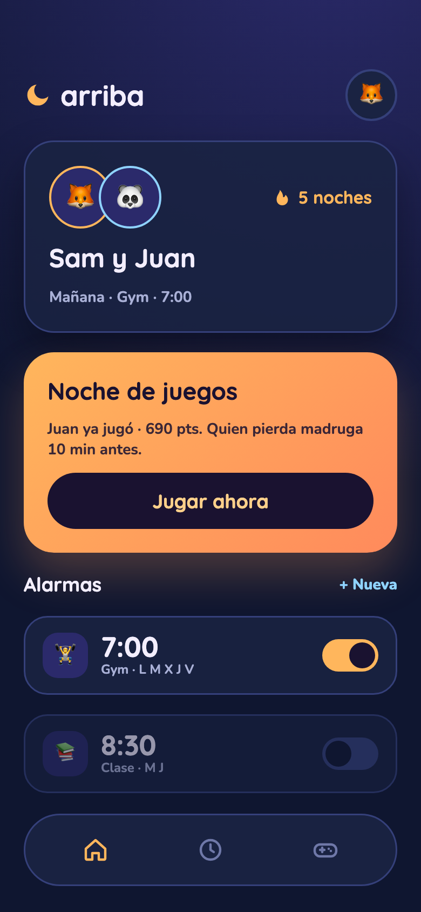
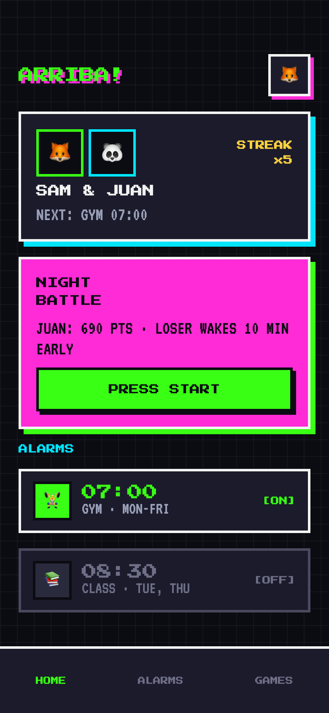
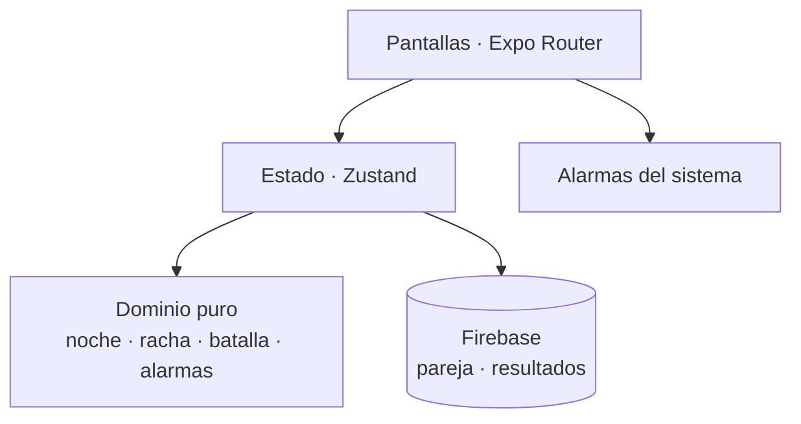

# SleepyTwo · despertador para parejas

> **In English:** A mobile alarm app for couples (Expo / React Native + Firebase). Each night
> both play short mini-games; in the morning the alarm and the result decide who wins, with a
> 2D battle and a shared streak. This repo is a case study plus a small tested example of the
> pure domain logic: the app's code is private.

App móvil para que una pareja se despierte a la vez y con ganas: por la noche juegan a minijuegos,
y por la mañana la alarma les enseña quién ha ganado con una batalla 2D y la racha de noches seguidas.

| Diseño · dirección nocturna | Diseño · dirección arcade |
|---|---|
|  |  |

Dos direcciones visuales de la pantalla de inicio que se valoraron al diseñar la app (con el nombre
provisional «arriba» y datos de ejemplo).

## Decisiones técnicas

- **Expo 57 + Expo Router**: una sola base de código para iOS, Android y web, con navegación por ficheros.
- **Skia + Reanimated** para la batalla 2D: dibujo y animación en el hilo de UI, a 60 fps en móviles modestos.
- **Zustand** para el estado de la pantalla y **Firebase** para la pareja, las invitaciones y la
  sincronización de resultados entre los dos móviles.
- **Dominio puro separado de la UI.** Las reglas (a qué noche pertenece un momento, la racha, la
  simulación de la batalla, las alarmas) son funciones sin React ni Firebase, así que se prueban con
  tests rápidos y la batalla es determinista: los dos móviles ven el mismo combate.



## Ejemplo

[`ejemplos/noche.ts`](ejemplos/noche.ts) es una versión reescrita de una regla del dominio:

- **La noche de juego no cambia a medianoche, sino a las 12:00.** Si cambiara a las 00:00, el
  resultado desaparecería justo cuando la pareja se despierta para verlo.
- **La racha** cuenta noches seguidas y no se pierde hasta que pasa el día sin jugar.
- Los tests cubren medianoche, mediodía y los dos cambios de hora del año.

```bash
cd ejemplos && npm install && npm test
```

## Stack

TypeScript · React Native · Expo 57 · Expo Router · Skia · Reanimated · Zustand · Firebase · Luxon · Vitest

---

© 2026 Samuel Vera. Todos los derechos reservados: ver [LICENSE](LICENSE).
